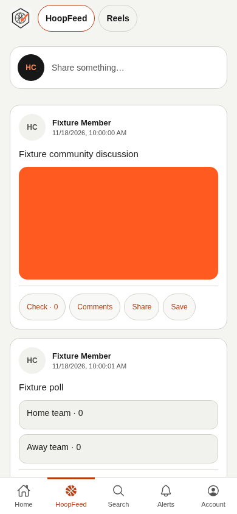
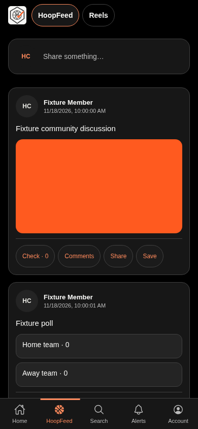

# HoopFeed visual follow-up (Build 8 held)

Stacked on PR #710 (`feat/native-hoopfeed`, baseline 36164095), rather than
reimplementing its real community client. This branch does not modify #710 or
the separate touch investigation #700. Integrate/rebase these dependencies and
rerun checks before considering release. No merge, deployment, EAS build, OTA,
production data mutation, migration, or permission change is part of this work.

## Reference and changes

Source reference: `app/feed/page.tsx`, `app/feed/feed-organization.css`,
`app/hoopfeed-shared.css`, `components/HoopFeedShared.tsx`, existing native theme
tokens, and bundled official `assets/hoopcheck-mark.png`. Signed-in website
access was not needed.

- Replace the duplicate stack title with one branded Feed/Reels navigation row.
  Include the top safe area when hiding the stack header.
- Use the website's collapsed “Share something…” composer and expanded editor,
  retaining drafts on close or moderation rejection. Put it inside the feed's
  scrolling content so it does not pin a large editor above every post.
- Use compact author rows, 14px card padding, theme surfaces, 14px media corners,
  15px body text, and bordered action pills with 44px touch targets.
- Size photos from actual loaded dimensions, capped at 520px, with explicit
  loading and retry states. The old fixed 300px `contain` panel left unused
  media space. Use cross-platform `Image.getSize`: React Native Web does not
  supply the native image event's source dimensions.
- Reuse #710’s updated platform-specific video lifecycle fix. Native video
  replacement remains asynchronous; web playback promises are handled there.
- Keep existing real moderated posts/comments/replies, caller-scoped Checks and
  aggregate RPC totals, bookmark API, canonical sharing, Reels and entitlement
  gating. No client-generated database counts or content are added.

A source scan found no fixture/demo content in native app/components/src.
Synthetic content remains confined to test scripts; screenshots below are
explicitly synthetic test evidence, never production content.

## Verification

- Mobile TypeScript and changed-file ESLint pass.
- Native contract suite, auth integration and Supabase URL tests pass.
- Root entitlement matrix and static HoopFeed RLS safeguards pass (not live DB tests).
- Local web export and local iOS Hermes export pass. An export is not a native
  compilation, simulator launch, or EAS build.
- Isolated Chromium at 390x844 passes in light and dark: failed media authorization
  and retry, decoded 640px image and visible dimensions, no duplicate feed heading,
  moderation rejection/draft retention and accepted posting, loaded comments,
  reply publication, Check count/state, Save state, canonical share link, poll
  voting, scrolling to offscreen content, Reels video playback, Alerts, Account,
  Search and Home. Denied membership starts no protected feed query.
- Discovery/navigation passes in both themes; appearance preference persistence,
  reload, system changes and failed-save isolation pass.
- All remote requests in browser tests are intercepted. No live posting,
  production media requests, database mutation, or real share is performed.

Reproduce with the fixture environment and commands in `../native-community.md`.
`verify-feed-browser.cjs` now generates a visible 640x360 orange test photo
instead of accepting a one-pixel image as proof of rendering.

## Required macOS / physical iPhone checks (not run here)

This Linux workspace has neither Xcode/iOS Simulator nor an attached iPhone.
Keep the PR draft and Build 8 held until native runtime evidence and CI pass.

1. Compile and launch the integrated branch on iOS. Check light/dark, small
   screens, Dynamic Type, VoiceOver, top/bottom insets and keyboard avoidance.
2. In an isolated test environment, scroll a long feed, expand/close composer,
   type without focus loss, post/reply, Check/uncheck, save/unsave, use the native
   share sheet and return through every tab and linked post.
3. Verify real image formats/orientations, image errors/retry, AVPlayer video
   playback, Reels paging, background pause, signed URL expiry/renewal and slow
   network. Chromium WebM playback does not prove native AVPlayer behavior.
4. Verify free/paid/expired membership, identity switching, offline/reconnect,
   moderation rejection and real aggregate counts using isolated accounts/data.
5. Complete #700's separate hydration/onboarding/app-lock/touch checks. These
   visual changes do not establish that the Build 7 freeze is repaired.

This follow-up does not claim complete website feature parity: website segment
and sort controls, native uploads/poll creation, report/block and edit/delete UI
remain outside this patch, as described by #710. Author avatars still use the
existing native HC fallback. Live role-matrix/database integration remains a
release gate; synthetic tests verify client behavior only.
